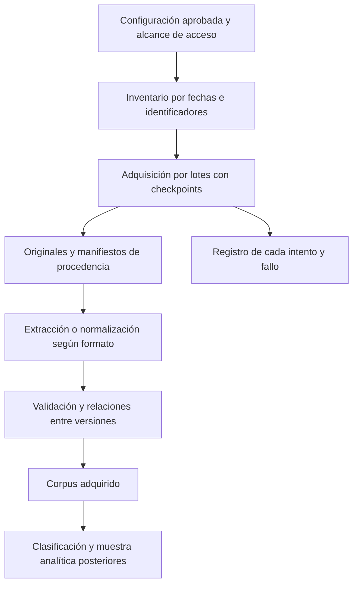

# Viabilidad de adquisición de noticias de Reuters de 2026

**Fecha de consulta:** 2026-10-21, America/Santiago.  
**Estado:** investigación documental y propuesta técnica para revisión; no constituye una selección científica del corpus ni una contratación aprobada.

## 1. Recomendación para decidir

El objetivo de un programa que descargue noticias de Reuters es técnicamente viable por varias rutas. **No se ha demostrado una ruta gratuita que combine texto completo, cobertura amplia de 2026 y permisos de adquisición y conservación suficientes.** La restricción observada en la web no demuestra que Reuters sea inaccesible por sus productos de distribución.

Recomiendo preparar un **descargador por lotes, reanudable e independiente del proveedor**, y escoger su primer adaptador después de verificar cobertura y derechos:

1. **Archivo LSEG Machine Readable News / News Archive:** primer candidato para estudiar disponibilidad temporal y versiones de noticias en investigación financiera. El proveedor documenta noticias estructuradas y archivo desde 1996; falta verificar el paquete Reuters de 2026, sus derechos y su precio. [Servicio MRN de LSEG](https://www.lseg.com/en/data-analytics/financial-news-service/machine-readable-news).
2. **Reuters API y entrega de archivo con licencia:** candidato para una adquisición amplia de producción editorial original. Reuters documenta API, entrega de archivos y productos de texto; falta verificar descarga retrospectiva de 2026 y uso académico persistente. [Entrega de Reuters](https://reutersagency.com/content-delivery-platforms/content-delivery), [productos de texto](https://reutersagency.com/content/content-types/text/).
3. **Factiva Analytics/Snapshots:** alternativa si su contrato incluye las fuentes Reuters requeridas y permite extraerlas para análisis. La existencia de Reuters en la interfaz de lectura no garantiza su disponibilidad en el producto de extracción. [Contenido de Factiva](https://proquest.libguides.com/factiva/content), [SDK oficial de Dow Jones](https://github.com/dowjones/factiva-analytics-python).

Si se obtiene permiso específico para HTML, un scraper convencional puede ser un adaptador adicional. **Dedicar más tiempo al scraping no resuelve derechos ausentes, páginas no publicadas en ese portal, versiones perdidas ni huecos de archivo.** No recomiendo construir la plataforma alrededor de técnicas para sortear bloqueos.

## 2. Qué significa cubrir Reuters en 2026

Hay tres universos diferentes que el investigador debe elegir o distinguir antes de evaluar completitud:

- Piezas producidas por las agencias y servicios de Reuters, incluidas alertas, ampliaciones y correcciones.
- Artículos publicados en `reuters.com`, que no deben asumirse equivalentes al cable completo.
- Republicaciones atribuidas a Reuters en plataformas de terceros, con selección, horarios y posibles ediciones propios.

Son distinciones de procedencia; este informe no establece una regla definitiva de inclusión. El corpus seguirá siendo general y sin filtros iniciales de oro, commodities o tickers.

Al 21 de octubre, **2026 todavía no terminó**. Deben separarse recuperación retrospectiva de lo publicado hasta una fecha de corte y captura futura hasta diciembre. No se promete un corpus anual completo hoy. Tampoco se modifica el filtro del piloto, que termina el 15 de octubre de 2026: ampliar ese período sigue siendo una decisión explícita pendiente.

Se usan tres niveles de evidencia:

- **Observado localmente:** solicitud y respuesta conservadas en el repositorio.
- **Documentado por el proveedor/autor:** característica pública; no implica acceso probado con una cuenta del proyecto.
- **Propuesto o pendiente:** inferencia de ingeniería, requisito contractual o medición todavía no realizada.

Las cifras comerciales de volumen o antigüedad describen productos, **no el número verificado de artículos Reuters de 2026**.

## 3. Separación entre problemas técnicos y restricciones de acceso

| Situación | Naturaleza | Evidencia o diagnóstico | Respuesta técnica adecuada |
|---|---|---|---|
| Cadena TLS institucional no reconocida por requests | Entorno | El piloto produjo `SSLCertVerificationError`; usando confianza de Windows se obtuvo HTTP 200 para robots. | Utilizar certificados institucionales verificados y registrar el modo de confianza; no desactivar TLS. |
| DNS, timeout o firewall | Conectividad | No prueban denegación editorial ni ausencia de noticias. No se midieron para todos los proveedores. | Registrar excepción y destino; revisar conectividad con TI. |
| Reglas de robots negativas | Política declarada de rastreo | En la copia recibida de Reuters, el agente del piloto no puede acceder a sus dos semillas. | Mantener la decisión de acceso explícita; usar otra vía autorizada o acordar acceso con la fuente. |
| Login, suscripción, autorización de API o permiso de fuente ausentes | Restricción de acceso | Debe confirmarse con el producto y contrato correctos; no se probaron cuentas nuevas. | Obtener el acceso correspondiente; conservar la evidencia del alcance autorizado. |
| HTTP 401, 403, 429 o challenge | Autenticación, denegación o limitación; origen por verificar | El código y el cuerpo ayudan a identificar si responde el servicio o un intermediario institucional. | Clasificar por separado; respetar `Retry-After`; detenerse ante acceso denegado. |
| HTML vacío, JavaScript o parser desactualizado | Implementación, si el acceso está permitido | Requiere una muestra autorizada; el test sintético no prueba el HTML real de 2026. | Probar JSON-LD/HTML y, si hace falta, navegador automatizado convencional. |
| Sección actual sin archivo histórico | Descubrimiento y cobertura | Una petición exitosa no enumera todo el año. | Inventario por fechas, paginación verificable o manifiesto del proveedor. |
| Restricción de retención, TDM o redistribución | Uso de los datos | Independiente de que la descarga sea técnicamente posible. | Seleccionar un producto cuyo contrato cubra las operaciones necesarias. |

`robots.txt` no es autenticación: el propio protocolo diferencia reglas de rastreo y autorización. Tampoco un `Allow` concede una licencia sobre el contenido. Por eso no se interpreta una prohibición de robots como una imposibilidad técnica universal ni se presenta ignorarla como solución de permisos. [RFC 9309, introducción](https://www.rfc-editor.org/rfc/rfc9309.html#section-1).

La evidencia local está en el [informe del piloto](reuters_pilot_test_report.md), el [registro TLS](../data/diagnostics/reuters_20261021T195039816697Z/http.jsonl), la [respuesta de robots](../data/diagnostics/reuters_20261021T195209007651Z/robots_response_1.txt) y las [decisiones por semilla](../data/diagnostics/reuters_20261021T195209007651Z/robots_decisions.jsonl). Esas corridas no solicitaron artículos. El aviso de la respuesta remite a permiso escrito para recopilación automatizada.

## 4. Comparación de rutas

Las valoraciones de reproducibilidad son propuestas de ingeniería, condicionadas a poder conservar los datos. **Ninguna fila representa cobertura de 2026 medida en este trabajo.**

| Ruta | Contenido y cobertura de 2026 | Acceso necesario | Coste conocido | Reproducibilidad potencial | Papel recomendado |
|---|---|---|---|---|---|
| HTML directo de Reuters | Texto de páginas accesibles; inventario anual no demostrado | Permiso de automatización y conservación; acceso a las páginas correspondientes | No hay cotización de permiso; coste de mantenimiento y equipo | Media si se conservan respuestas y versiones | Condicional a autorización; no usar las dos semillas actuales como archivo anual |
| Reuters API / archivos entregados | Producción licenciada; retrospectiva y paquetes por confirmar | Contrato, cuenta y permisos del producto | Cotización | Alta con IDs, versiones y manifiesto | Candidato principal para corpus editorial amplio |
| LSEG MRN / News Archive | Archivo histórico documentado; paquete Reuters y meses 2026 por confirmar | Licencia de archivo y derechos de análisis/retención | Cotización | Alta con entregas históricas y tiempos originales | Candidato principal para archivo temporal estructurado |
| LSEG Workspace / biblioteca Python | Titulares e historias; ventana documentada de 15 meses | Variante y permisos de contenido/API adecuados | Suscripción y posibles complementos; sin importe verificado | Media-alta, si se permiten snapshots locales | Piloto o lote limitado; verificar ventana y límites |
| Factiva Analytics / Snapshots | Archivo consultable; Reuters 2026 debe confirmarse por fuente y producto | Licencia de extracción, no solo consulta | Cotización; posible convenio institucional sin confirmar | Alta si se entrega snapshot identificable | Alternativa de archivo |
| Nexis Data+ / exportación institucional autorizada | Noticias históricas y actuales; inclusión concreta de Reuters no verificada | Fuente contratada, API/TDM y retención autorizadas | Cotización o convenio por confirmar | Alta con exportación y consulta preservadas | Alternativa pendiente de catálogo |
| Yahoo, Investing y otros republicadores | Existe evidencia pública de republicaciones 2026; subconjunto de tamaño desconocido | Permisos del portal y derechos aplicables a los textos Reuters | Lectura puede ser gratuita; automatización no incluida por ello | Media-baja sin IDs originales y versiones | Complemento o muestra explícitamente limitada |
| Common Crawl CC-MAIN | Capturas WARC; disponibilidad de Reuters 2026 no medida | Acceso al archivo y usos compatibles con derechos del contenido | Datos de acceso gratuito; disco, proceso y posibles servicios cloud aparte | Alta para capturas fijadas; cobertura incompleta | Inventario exploratorio y complemento |
| Common Crawl CC-NEWS / índices derivados | Archivo de noticias desde 2016; Reuters y corte 2026 por verificar | Derechos del archivo y del contenido | Acceso gratuito al archivo; procesamiento potencialmente elevado | Alta con WARC/snapshot fijado | Explorar antes de descargar grandes volúmenes |
| Internet Archive / Wayback | Capturas puntuales; cobertura Reuters 2026 desconocida | Acceso y reutilización permitidos; límites del servicio | Sin precio general de consulta identificado; posible acuerdo específico | Media-alta por captura, con posibles exclusiones | Recuperación y auditoría de casos, no base única |
| GDELT / buscadores / NewsAPI | Principalmente descubrimiento y metadatos; no equivalen a cuerpos completos | Condiciones de cada índice; derechos adicionales para descargar textos | GDELT abierto; NewsAPI tiene planes publicados | Media si se congelan resultados y consultas | Capa de descubrimiento y contraste |
| FNSPID, RCV1/2, TRC2 y colecciones antiguas | Sus períodos documentados no incluyen 2026 | Licencia particular de cada corpus | Condiciones distintas; no se contrataron | Buena para la versión fija correspondiente | Fixtures o antecedentes; no resuelven el objetivo temporal |

### 4.1 Acceso directo: HTTP, navegador, sitemaps y formatos alternativos

Un scraper autorizado puede separar descubrimiento de adquisición, descargar HTML con un agente identificable y extraer metadatos y cuerpo. Si el contenido permitido requiere JavaScript, un navegador automatizado puede resolver renderizado. Su uso no garantiza superar restricciones ni reconstruir páginas históricas inexistentes.

Sitemaps, índices públicos, enlaces internos y feeds sirven para enumerar URLs **cuando su acceso está permitido**. Su presencia en robots no los convierte en una autorización de descarga ni garantiza la cobertura de un año. No se solicitó el sitemap Reuters durante esta investigación ni se validó un RSS público general que entregue todo 2026.

Los endpoints internos de una web o aplicación no deben confundirse con una API pública documentada para clientes. Este informe no los adopta como infraestructura estable ni ejecuta pruebas sobre ellos. Tampoco recomienda suplantar agentes autorizados, cambiar identidades para seguir tras una denegación, resolver challenges por terceros o buscar otra representación de un artículo para eludir su control de acceso.

**Condición que haría viable esta ruta:** autorización verificable de Reuters que cubra URLs/servicio, agente, frecuencia, período, descarga de cuerpos y conservación para el proyecto. Si la autorización contempla reglas específicas distintas de robots, deben quedar acordadas con el proveedor y registradas, en lugar de introducir un interruptor general para ignorar restricciones.

### 4.2 Reuters API, Connect y entregas de archivos

Reuters describe una API basada en GraphQL con formatos JSON, además de Content Downloader, FTP Push/XML y RSS para contenido suscrito. Son mecanismos de entrega licenciada, no evidencia de que todos estén habilitados para este proyecto. [Métodos de entrega](https://reutersagency.com/content-delivery-platforms/content-delivery).

Reuters también ofrece un producto Complete Text Newswire en inglés, con alcance general, y paquetes por idioma o especialidad. La existencia de varios paquetes obliga a precisar el contratado: un feed financiero o una lengua no equivale a toda la producción Reuters. [Catálogo de texto](https://reutersagency.com/content/content-types/text/).

Connect anuncia archivo multimedia desde 1896; esa fecha **no demuestra un archivo textual uniforme desde entonces ni cobertura completa de 2026**. Sus precios se presentan como planes flexibles, sin una tarifa pública de corpus académico verificada. [Reuters Connect](https://reutersagency.com/content-delivery-platforms/reuters-connect/).

Las condiciones generales de la plataforma requieren consentimiento previo para automatización, TDM y archivo; por tanto, contratar lectura y luego automatizar su interfaz no es equivalente a contratar la API. Deben obtenerse las condiciones específicas del suministro. [Condiciones Connect, sección 8](https://www.reutersconnect.com/general-terms).

Reuters comercializa además contenido para AI Training & RAG. Puede ser una vía para solicitar un acuerdo de análisis computacional, pero no se presume que entrenar modelos y aplicar NLP académico tengan idéntico precio o licencia. [Oferta de datos para AI/RAG](https://reutersagency.com/solutions/ai-training-rag/).

**Preguntas pendientes:** ¿ofrece backfill enero–octubre 2026 y actualización hasta diciembre?, ¿entrega todas las versiones o solo la final?, ¿hay enumeración completa?, ¿se permiten almacenamiento local, backups, análisis y publicación de resultados derivados? La respuesta comercial debe distinguir texto original de assets de terceros.

### 4.3 LSEG: archivo histórico y API de escritorio son productos distintos

MRN documenta titulares, historias y metadatos estructurados de Reuters y otros proveedores, junto con archivo desde 1996 y datos de disponibilidad temporal. Es un candidato fuerte para evitar depender de HTML cambiante. La mención a numerosos proveedores impide usar el volumen agregado del producto como conteo Reuters. [MRN y News Archive](https://www.lseg.com/en/data-analytics/financial-news-service/machine-readable-news).

LSEG identifica acceso programático y entrega SFTP entre sus opciones de noticias. Antes de elegir transporte, debe verificarse qué modalidad aplica al archivo contratado, su esquema y las restricciones de la red institucional. [Catálogo de noticias LSEG](https://www.lseg.com/en/data-catalogue/news).

La documentación de la biblioteca Python distingue sesión Desktop —con Workspace en la misma máquina— de Platform, que requiere licencia propia. Documenta 15 meses de historial de titulares y obtención de historias por ID. Los límites dependen del producto y pueden cambiar. No corresponde aplicar el antiguo límite Eikon de 100 titulares a todas las interfaces actuales. [Documentación de LSEG Data Library](https://developers.lseg.com/en/api-catalog/lseg-data-platform/lseg-data-library-for-python/documentation).

**Implicación propuesta:** 2026 transcurrido cabe temporalmente en esa ventana al consultar en octubre de 2026, pero eso no demuestra que la cuenta incluya todo el contenido. Una consulta realizada mucho después perderá acceso por la ventana móvil. Una licencia de escritorio tampoco se presupone válida para un servicio compartido permanente.

### 4.4 Factiva, Nexis y acceso institucional

Factiva identifica Reuters entre sus agencias. El SDK oficial de Dow Jones implementa estimación de volumen y extracción de snapshots, con jobs, archivos y autenticación. También distingue ArticleFetcher como herramienta para visualización: no debe usarse esa función como supuesto permiso de corpus. [Catálogo de contenido](https://proquest.libguides.com/factiva/content), [SDK oficial](https://github.com/dowjones/factiva-analytics-python).

Nexis Data+ anuncia noticias actuales e históricas mediante API y contenido licenciado. **No se confirmó que la licencia concreta incluya Reuters de 2026 ni exportación de sus cuerpos completos.** Debe verificarse antes de preferirlo a Reuters/LSEG. [Nexis Data+: noticias](https://www.lexisnexis.com/en-gb/products/data/data-sets/news-media), [portal del desarrollador](https://dev.lexisnexis.com/).

La consulta pública del [catálogo de Biblioteca UDD](https://biblioteca.udd.cl/bases-de-datos/) no permitió verificar una suscripción a Factiva, Nexis o un paquete Reuters con TDM. No se accedió a cuentas institucionales. Una referencia a ProQuest Ebook Central no demostraría acceso a una base de noticias.

**Acción de mayor valor antes de pagar:** consultar con Biblioteca/TI qué contratos existen, si cubren la fuente Reuters pertinente y qué mecanismo de exportación permiten. Esto es una propuesta; no se enviaron mensajes ni solicitudes a terceros.

### 4.5 Republicaciones: Yahoo, Investing, Nasdaq y medios locales

Se localizaron ejemplos indexados de Reuters en Yahoo Finance con fecha de octubre de 2026, como [una pieza del 9 de octubre](https://finance.yahoo.com/markets/stocks/articles/wall-st-futures-gain-oil-102454068.html). Esto prueba existencia de ejemplos, no una proporción recuperable ni un permiso de scraping. No se descargó un corpus para validar esos metadatos.

Las [condiciones de Yahoo](https://legal.yahoo.com/us/en/yahoo/terms/otos/index.html) condicionan la recolección automatizada a permiso previo. Las de [Investing, sección 10](https://cdn.investing.com/about-us/terms_and_conditions.pdf) restringen expresamente la extracción automatizada. Por ello, cambiar de portal no elimina la necesidad de verificar permisos.

Nasdaq y otros republicadores son candidatos individuales por validar: no se acreditó un inventario Reuters de 2026 ni un contrato de extracción aplicable. No se extrapola el scraper Nasdaq de un dataset de años anteriores al diseño actual del portal.

Si un distribuidor autoriza el suministro, conservar `editorial_source=Reuters` y `acquisition_platform=<distribuidor>`. La fecha de republicación debe distinguirse de la de producción original. El titular puede variar y una fotografía acreditada a Reuters o una mención a Reuters en el texto no demuestra autoría de la noticia completa. Las reglas definitivas de atribución y muestra requieren aprobación del investigador.

### 4.6 Common Crawl: CC-MAIN, CC-NEWS e índices derivados

Common Crawl ofrece acceso gratuito a sus datos, pero el procesamiento y almacenamiento no son necesariamente gratuitos. [Acceso a datos](https://commoncrawl.org/get-started).

En CC-MAIN, CDXJ permite identificar URL, timestamp, archivo WARC, offset, longitud y digest. Eso permite seleccionar capturas y recuperar registros concretos sin descargar todo un mes, cuando corresponda hacerlo. Es una ruta técnicamente reproducible si se fijan colección, identificadores y hashes. [Esquema CDXJ](https://www.commoncrawl.org/cdxj-index), [herramientas oficiales](https://github.com/commoncrawl/whirlwind-python).

**CC-NEWS es una colección diferente**, con WARC organizados por año/mes desde 2016 y publicación frecuente. No debe asumirse que el índice de CC-MAIN la enumera. [Descripción oficial CC-NEWS](https://commoncrawl.org/blog/news-dataset-available).

Common Crawl declara que su colección es una muestra de la web y que su crawler consulta robots y no ejecuta JavaScript. Su API de índices tiene límites operativos. Esto debilita cualquier promesa de texto completo o cobertura exhaustiva de Reuters. [FAQ técnica](https://commoncrawl.org/faq).

El acceso al archivo tampoco sustituye derechos sobre el contenido original: sus términos separan el servicio de las condiciones y derechos de páginas capturadas. [Condiciones Common Crawl, secciones 2–3](https://commoncrawl.org/terms-of-use).

Como opción adicional de descubrimiento, el trabajo **Infini-News**, publicado en mayo de 2026, describe un índice derivado de CC-NEWS. Su resumen no acredita cobertura de Reuters durante todo 2026 ni el derecho del proyecto a redistribuir esos textos. Puede reducir coste de búsqueda si se verifican snapshot y licencia, pero no debe confundirse con una fuente editorial independiente. [Publicación de los autores](https://arxiv.org/abs/2605.18337).

La consulta web acotada a un índice CC-MAIN de 2026 no fue accesible mediante la herramienta utilizada. **No se obtuvo conteo Reuters ni se descargaron registros WARC.** No se interpreta ese fallo como colección vacía.

### 4.7 Internet Archive / Wayback

El CDX de Wayback permite buscar capturas por URL y fecha. Sería útil para auditar o recuperar casos concretos cuando el acceso y uso estén permitidos; una captura debe identificarse por timestamp y digest. [Documentación oficial del servidor CDX](https://github.com/internetarchive/wayback/blob/master/wayback-cdx-server/README.md).

Internet Archive no garantiza la situación de copyright de los elementos almacenados. No se verificó disponibilidad Reuters 2026 ni se hicieron solicitudes de capturas. Una fecha de captura es evidencia de observación en archivo, no fecha de publicación ni primera disponibilidad al mercado. [Información oficial sobre derechos](https://archivesupport.zendesk.com/hc/en-us/articles/360014759692-Rights).

### 4.8 GDELT, buscadores y APIs de descubrimiento

GDELT DOC permite buscar sobre texto indexado, pero sus listados no son una exportación de cuerpos completos. Su documentación describe una ventana móvil de tres meses y un máximo de 250 resultados por listado; ese endpoint no basta para enero–octubre de 2026. [Documentación DOC](https://blog.gdeltproject.org/gdelt-doc-2-0-api-debuts/amp/).

El archivo GDELT/GKG es otro recurso, con URLs y metadatos históricos: no debe confundirse con la ventana DOC ni con una licencia de noticias Reuters. [Datos GDELT](https://gdeltproject.org/data.html).

Buscadores y feeds pueden aportar URLs candidatas, sujetos a sus condiciones. Sus resultados, rankings y truncamientos no son un denominador editorial completo. Buscar solo `domain:reuters.com` tampoco encontrará republicaciones en otros dominios y buscar la palabra Reuters añade menciones ajenas a la autoría.

NewsAPI publica un plan Developer gratuito y planes Business y Advanced de **USD 449 y USD 1.749 mensuales**, respectivamente, con facturación mensual en la página consultada. Documenta hasta cinco años de búsqueda para planes de pago, pero declara que **ningún plan devuelve el cuerpo completo**. Pagarlo no resuelve el objetivo central ni autoriza descargar las URLs devueltas. Las tarifas y condiciones deben reconfirmarse antes de contratar. [Precios y FAQ oficiales](https://newsapi.org/pricing).

### 4.9 Datasets históricos preexistentes

- **FNSPID:** los autores documentan 1999–2023 y selección asociada a empresas; no suministra el universo general Reuters 2026. Un procedimiento para actualizarlo no equivale a disponer de datos de 2026 ni de permisos nuevos. [Artículo original](https://arxiv.org/abs/2402.06698), [repositorio de los autores](https://github.com/Zdong104/FNSPID_Financial_News_Dataset).
- **RCV1/RCV2:** NIST documenta 1996–1997; **TRC2**, 2008–2009. No cubren 2026 y tienen acuerdos propios de acceso y uso. [Reuters Corpora en NIST](https://trec.nist.gov/data/reuters/reuters.html).
- Colecciones antiguas de titulares o mezclas Reuters/Bloomberg no demuestran un archivo actual de cuerpos íntegros. La licencia del código de un repositorio no concede automáticamente derechos sobre noticias ajenas. El repositorio histórico `philipperemy/Reuters-full-data-set` devolvió HTTP 451 mediante la herramienta web; no se intentó sortearlo ni descargar una copia alternativa.

No se verificó un dataset descargable con Reuters 2026 completo, procedencia suficiente y permisos claros. Estos antecedentes sirven para diseño y pruebas, sin cambiar el período científico solicitado.

## 5. Costos: qué se puede presupuestar y qué falta

Para Reuters, LSEG, Factiva y Nexis **no se encontró una cotización pública aplicable a este corpus**. No se asignan cifras inventadas ni se supone que una cuenta institucional lo cubra. Una solicitud de presupuesto debería separar:

| Componente | Qué pedir o estimar |
|---|---|
| Contenido histórico | Texto Reuters 2026 hasta el corte, idiomas y regiones cubiertas, originales y versiones, exclusiones |
| Actualización posterior | Resto de 2026, entrega periódica y posibilidad de recuperar huecos |
| Uso | TDM/NLP, almacenamiento, backups, retención tras finalizar la suscripción, usuarios y colaboradores |
| Resultados publicables | Estadísticas, hashes/identificadores, fragmentos, modelos y restricciones de reconstrucción |
| Servicio | API o archivos, cuotas y sobreconsumo, soporte, posibilidad de estimar volumen antes de descargar |
| Infraestructura | Disco, backups, horas de mantenimiento, procesamiento y red; nube solo con presupuesto aprobado |

Modelo de comparación propuesto: `coste total = licencia + infraestructura + operación + revisión de calidad y permisos`. El tiempo de ejecución puede relajarse según la preferencia del investigador; los otros componentes siguen existiendo. No se requieren feeds de mínima latencia solo para recuperar un archivo anual.

## 6. Arquitectura propuesta

### 6.1 Componentes mínimos

Propuesta, no implementación: una entrada de ejecución, un adaptador del proveedor elegido y funciones de normalización/validación. JSONL y archivos de estado bastan para el piloto; no se justifica aún un sistema distribuido. Si el trabajo es secuencial, un checkpoint por lote escrito de forma atómica permite reanudar sin repetir todo.

El adaptador podría consumir API, exportación JSON/XML o HTML autorizado. Una respuesta estructurada no necesita pasar por un extractor HTML. La URL es un identificador útil, pero no debe ser obligatoria cuando el proveedor entregue un ID estable de agencia.

### 6.2 Auditoría y procedencia

Guardar por ejecución versión del código, lockfile/dependencias, configuración, corte temporal, consulta, proveedor/producto, modo TLS y referencia al acuerdo de acceso. Guardar credenciales fuera de logs y del repositorio.

Por documento, conservar cuando existan: ID original, ID del distribuidor, URL original y canónica, plataforma de adquisición, editor original, título, texto, idioma, autores, fecha original y zona horaria, actualizaciones, primera observación, recuperación, versión, hash y método de extracción. Señalar datos faltantes e inferidos. Para archivos, añadir colección, nombre, offset/longitud y digest cuando correspondan.

Mantener la relación entre original, actualización y republicación. Deduplicar bytes o textos exactos no autoriza a fusionar automáticamente cobertura independiente del mismo evento. Separar fecha de agencia, de republicación, de captura de archivo y de recuperación evita aparentar disponibilidad temporal que no se comprobó.

Los originales se conservarían sin edición, dentro del plazo y usos permitidos; si una licencia exige borrado al vencer, la política de retención debe reflejarlo. La reproducibilidad pública puede requerir publicar código, consultas y estadísticas, dejando los textos en almacenamiento restringido.

### 6.3 Recuperación ante fallos

- Validación TLS activa; confianza institucional configurable y registrada.
- Clasificaciones distintas para robots restrictivo, robots inaccesible/inválido, conectividad, autenticación, HTTP denegado, rate limiting y parser.
- Pausas y límites por destino para todas las solicitudes; reintentos finitos para fallos transitorios con backoff y `Retry-After`.
- Verificación del destino antes de seguir cada redirección en el adaptador HTML.
- Checkpoints, registro de intentos fallidos y detección de respuestas truncadas o páginas repetidas.
- Conservación de versiones en lugar de sobrescribir la noticia recuperada previamente.

Estas medidas corrigen límites técnicos del piloto. No habilitan derechos de acceso por sí solas.

## 7. Prueba pequeña para elegir proveedor

**Propuesta todavía no ejecutada:** antes de contratar volumen o automatizar una nueva ruta, solicitar catálogo, condiciones y una muestra de hasta 30 documentos, distribuida entre los meses transcurridos de 2026 y distintos tipos de noticias. No es una muestra científica ni define el corpus final.

La evaluación debería responder:

1. ¿El proveedor enumera todas las piezas elegibles del paquete por fecha, o solo devuelve resultados de búsqueda limitados?
2. ¿Entrega cuerpos, IDs y fechas originales, con versiones o solo estado final?
3. ¿Los permisos cubren adquisición, almacenamiento, análisis y reproducibilidad del proyecto?
4. ¿Se pueden recuperar huecos, reanudar y repetir la consulta sin perder la trazabilidad?
5. ¿Qué fuente/idioma/tipo de pieza falta y cuánto cuesta el suministro completo?

Registrar denominadores por etapa: inventariadas, únicas, intentadas, autorizadas, descargadas, con cuerpo, extraídas, fechadas y válidas. Evaluar por mes, idioma y tipo de documento, sin filtrar por commodity. Contrastar la muestra con otra vía disponible y autorizada; medir versiones diferentes y desfases de publicación.

Una razón `documentos recuperados / inventario del proveedor` mide completitud **respecto de ese inventario**, no respecto de todo lo producido por Reuters. Si el proveedor no ofrece inventario, la cobertura completa seguirá sin poder establecerse. Los umbrales de calidad finales deben acordarse antes de escalar.

## 8. Decisión por escenario

| Prioridad del investigador | Primera alternativa a verificar | Arquitectura resultante |
|---|---|---|
| Archivo temporal estructurado para investigación | LSEG News Archive, con paquete y permisos de 2026 | Descarga de entregas históricas, normalización y control de versiones |
| Máxima amplitud de producción editorial Reuters | Reuters, acuerdo de texto/API y archivo retrospectivo | Adaptador Reuters con inventario y descarga de assets textuales |
| Aprovechar convenio existente de biblioteca | Factiva/Nexis con extracción autorizada y Reuters confirmado | Importador de snapshots o API contratada |
| Preferencia estricta por scraper HTML | Permiso escrito y muestra de páginas/índices históricos | HTTP primero; navegador solo donde sea necesario y permitido |
| Costo de licencia cero | Índices y archivos públicos, previa revisión de usos y cobertura | Inventario exploratorio; cuerpo solo donde corresponda; alcance incompleto explícito |

**Orden de avance recomendado:** confirmar recursos y condiciones existentes en UDD; comparar oferta de archivo LSEG y texto Reuters; verificar Factiva/Nexis si hay convenio; ejecutar la muestra pequeña de la ruta autorizada; implementar un solo adaptador inicialmente. Los archivos abiertos y republicaciones pueden aportar contraste y complementos, sin prometer el universo completo.

## 9. Trabajo realizado y límites de esta investigación

Se revisaron código/documentación local, resultados de la prueba anterior y documentación pública de proveedores, archivos y datasets. Se consultaron buscadores y páginas informativas; no se ejecutó un crawler ni se descargaron lotes de artículos, datasets completos o WARC. No se adquirieron cuentas, se asumieron costos ni se contactó a terceros.

Fallos de consulta relevantes, sin extrapolarlos al servicio completo: la herramienta web no abrió términos/robots de `reuters.com`; Liaison devolvió 503; los términos Yahoo sin parámetros devolvieron 999, aunque el buscador mostró el texto de la página oficial indexada; la consulta acotada del índice Common Crawl no fue accesible; el repositorio histórico citado devolvió 451. La política Reuters observada se fundamenta en la respuesta local conservada, no en una nueva descarga de su web.

No se utilizaron foros no oficiales para fijar precios, derechos o límites actuales. Las fechas y características publicitadas pueden cambiar: deben reconfirmarse en el producto y acuerdo elegidos. Las solicitudes comerciales, muestras autenticadas y cambios científicos siguen pendientes; este informe permite decidir qué verificar e implementar sin atribuirles aprobación.

**Archivo añadido:** este informe. No se modificaron el piloto, sus pruebas, las salidas originales ni el registro de decisiones aprobadas. No se realizaron commits ni operaciones remotas de Git.
